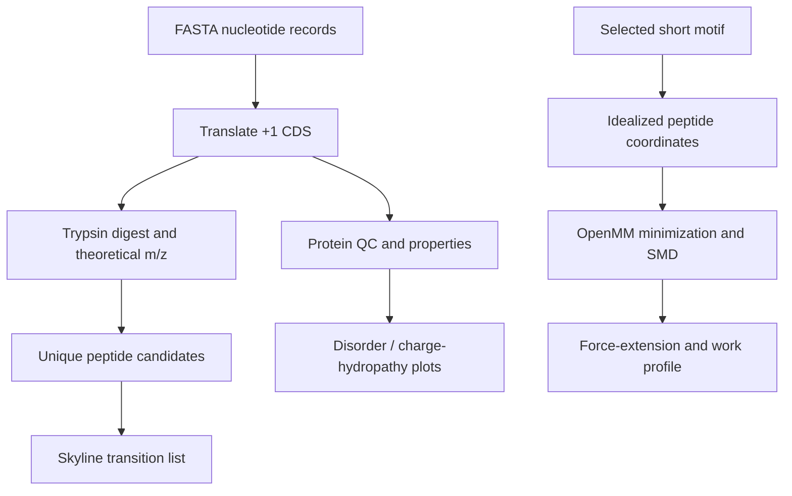

# Velvet Worm Slime Proteomics & Molecular Dynamics

[](https://github.com/gyagu98/velvet-worm-slime-proteomics-md/actions/workflows/tests.yml)
[](https://www.python.org/)
[](https://openmm.org/)

A reproducible research software project that investigates the sequence-level features and mechanical unfolding hypotheses of velvet worm (*Onychophora*) slime proteins. The project combines **computational proteomics** (protein property profiling, in silico enzymatic digestion, theoretical peptide m/z and MS/MS fragments) with **molecular dynamics** (OpenMM energy minimization and short steered molecular dynamics pulling of selected peptide motifs).

> **Important data limitation:** The provided FASTA files contain nucleotide coding sequences/transcripts, not proteomics spectra or measured protein abundance. The outputs are *in silico predictions* and demonstrations of computational methods, not experimental proteomics results. No mass-spectrometry identification, protein expression, secretion, or mechanical property is inferred from these sequence files alone.

## Project questions

1. How do PH (high-molecular-weight / proline-rich) and PM (mid-molecular-weight) slime-protein sequence sets differ in amino-acid composition, predicted molecular weight, charge, hydropathy, and sequence-based disorder indicators?
2. Which tryptic peptides are theoretically predicted, and which peptide sequences are unique within this FASTA collection and potentially useful as targeted-MS assay candidates?
3. What does a short **steered MD (SMD)** demonstration reveal about force-extension behavior for selected repeat motifs under specified, deliberately simplified simulation conditions?

These are computational hypotheses to guide future validation, not established biological conclusions.

## Included data

The two FASTA files in `data/` were supplied for this project:

- `Peripatus_slime_7_PH_no_gaps.fasta` — 15 records, labeled primarily as high-MW/proline-rich (PH) slime sequences.
- `Peripatus_slime_7_PM_no_gaps.fasta` — 18 records, labeled primarily as mid-MW (PM) slime sequences.

A first-pass audit found that the records are **nucleotide sequences**. The workflow translates them in the +1 frame using the standard genetic code. This is a reproducible starting assumption, but sequence provenance and reading frame should be confirmed against the source accession or original annotation before treating the translations as definitive proteins. One PH record, `Euperipatoides_rowelli__PH2__PP551270_1`, has 41 internal stop codons in the +1 translation. It is flagged, but remains in generated tables, so do not interpret its protein-level values until the ORF/frame is validated.

## Workflow



### Sequence-level proteomics outputs

- Protein length, average molecular weight, estimated pI, net charge at pH 7.4, GRAVY hydropathy, and amino-acid composition.
- FoldIndex-based sequence-level order/disorder heuristic and a sliding-window visualization.
- In silico tryptic digestion with adjustable missed cleavages and peptide length bounds.
- Theoretical monoisotopic precursor m/z values (z=1, 2, 3), approximate reversed-phase retention proxy, and theoretical b/y fragments.
- Peptide sequences unique **within this provided FASTA collection**; this is not a species-wide proteotypicity claim.
- Skyline-compatible transition-list CSV for candidate follow-up.

### Molecular dynamics demonstration

The SMD command generates an idealized backbone for a **short selected peptide motif**, adds missing atoms and hydrogens, minimizes it, and uses OpenMM with an Amber protein force field and implicit solvent. The N-terminal alpha carbon is restrained, while the C-terminal alpha carbon is pulled with a harmonic spring. Per-step records include end-to-end distance, force, potential energy, and accumulated mechanical work.

This MD scaffold is intentionally modest: it can demonstrate reproducible MD setup and analysis, but it is **not** a validated model of a full-length secreted slime protein or the bulk slime material. The current coordinate builder creates idealized starting geometries rather than using an experimentally determined or validated folded structure. SMD is non-equilibrium and sensitive to pulling speed, spring constant, conformation, force field, and solvent model. Do not report its outputs as experimental rupture forces or material constants.

## Quick start

### Local installation

Python 3.10+ is required. OpenMM and PDBFixer can be installed with pip or Conda/Mamba; Conda is often preferable when installing the scientific stack.

```bash
git clone https://github.com/gyagu98/velvet-worm-slime-proteomics-md.git
cd velvet-worm-slime-proteomics-md
python -m venv .venv
source .venv/bin/activate  # Windows: .venv\Scripts\activate
python -m pip install --upgrade pip
python -m pip install -e ".[dev]"
```

### Run sequence-level proteomics analysis

```bash
slime-proteo-md analyze \
  --fasta data/Peripatus_slime_7_PH_no_gaps.fasta \
  --fasta data/Peripatus_slime_7_PM_no_gaps.fasta \
  --out results/ \
  --ph 7.4 \
  --missed-cleavages 1 \
  --min-peptide-length 6 \
  --max-peptide-length 40
```

Expected outputs include:

- `protein_properties.csv`
- `tryptic_peptides.csv`
- `skyline_transition_list.csv` (when unique theoretical peptides exist)
- `proteomics_overview.png`
- Representative per-protein `*_disorder_profile.png` figures
- `sequence_summary.json`
- `analysis_report.md`

### Run the molecular-dynamics demonstration

Use a short motif selected from a translated record. For example, the PH FASTA's `Eoperipatus_sp_PM2_protein_A` sequence contains the repeated motif `PSEPGYPG`. Start with a short peptide representing that motif, not the 600+ AA full-length record:

```bash
slime-proteo-md smd \
  --sequence PSEPGYPGQPSEPGYP \
  --conformation extended \
  --steps 2000 \
  --report-interval 20 \
  --pull-velocity 0.02 \
  --spring-k 500 \
  --temperature 300 \
  --platform CPU \
  --out results/smd_demo/
```

This is a **method demonstration** on an idealized short peptide. The `--conformation` choices are `extended` and `polyproline_ii`. Results include `initial_peptide.pdb`, `smd_trajectory.pdb`, `smd_force_extension.csv`, `smd_mechanics_summary.json`, and `smd_mechanics.png`.

### Docker

```bash
docker build -t slime-proteo-md .
docker run --rm -v "$PWD/results:/app/results" slime-proteo-md analyze \
  --fasta data/Peripatus_slime_7_PH_no_gaps.fasta \
  --fasta data/Peripatus_slime_7_PM_no_gaps.fasta \
  --out results/
```

## Testing

```bash
python -m pip install -e ".[dev]"
pytest
```

The GitHub Actions workflow tests Python 3.10, 3.11, and 3.12, and runs a CLI smoke test.

## Interpretation and limitations

- No raw LC-MS/MS data, peptide identifications, protein abundance, replicate labels, or quantitative proteomics results were supplied. The project cannot claim a protein was detected or quantify differential abundance.
- Theoretical peptides and transitions should be evaluated for detectability (length, charge, hydrophobicity, modification susceptibility, and instrument method), synthesized/tested where appropriate, and validated against real spectra. The retention index is an approximate heuristic, not a trained predictor.
- The FASTA labels provide the PH/PM grouping. This does not mean the family assignment, abundance class, or functional annotation has been independently validated.
- Translation is standard-code +1 frame and is subject to sequence/provenance validation. The sequence with 41 internal stops is flagged in the generated report.
- FoldIndex and charge-hydropathy indicators are sequence heuristics and do not replace a structure prediction, NMR, or biophysical assay.
- The MD coordinate generator is idealized. The current PPII option uses a geometric scaffold and should not be interpreted as a fully validated, stereochemically optimized PPII structure without relaxation and independent validation.
- SMD forces/work depend on simulation setup and are not equilibrium free energies or measured material properties. Meaningful comparative MD needs a validated starting structure, replicated simulations, parameter sensitivity analysis, adequate sampling, and clear physical hypotheses.

## Suggested next experimental / computational steps

1. Validate ORFs and reconcile accession/header metadata, including the PH2 internal-stop record.
2. Obtain raw or processed slime LC-MS/MS data, annotate sample and replicate metadata, and run a proper peptide-spectrum search with a target-decoy strategy and FDR control.
3. Use proteomics-confirmed peptides to refine the sequence database and candidate targeted assay panel.
4. For MD, select a short sequence region with a justified structural hypothesis, build/validate a realistic structure, and compare replicated SMD runs under a small parameter sensitivity grid. A full slime-material model is a separate, much larger task.

## References

- Prilusky J. et al. FoldIndex: a simple tool to predict whether a given protein sequence is intrinsically unfolded. *Bioinformatics* (2005). https://doi.org/10.1093/bioinformatics/bti537
- Uversky V.N. What does it mean to be natively unfolded? *European Journal of Biochemistry* (2002). https://doi.org/10.1046/j.1432-1033.2002.02839.x
- OpenMM documentation: https://docs.openmm.org/
- PDBFixer: https://github.com/openmm/pdbfixer
- Skyline: https://skyline.ms/

## License

MIT License. See `LICENSE`.
